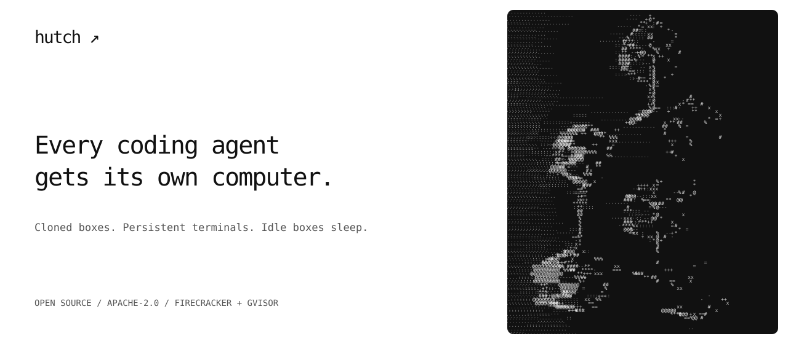

<p align="center"></p>

# Hutch

Every coding agent gets its own computer, on a Linux machine you rent or own. Hutch clones boxes from snapshots of your project's environment, keeps terminals running when you disconnect, and sleeps idle boxes. Machines with KVM use Firecracker microVMs; other machines use gVisor sandboxes.

Hutch is early software. Read the [v0.2.4 release notes](docs/releases/v0.2.4.md) for supported platforms and current limitations.

The CLI and TUI run on Linux, macOS, and Windows. A project has reusable template versions; each box has its own files and services; terminals in the same box share that environment. Claude Code and Codex have built-in adapters, and you can add a TOML adapter for another agent's CLI.

## Install

Install the CLI on Linux or macOS with:

```sh
curl -fsSL https://github.com/mouizahmed/hutch/releases/latest/download/install.sh | sh
```

The script verifies the archive's SHA-256 checksum and installs into `~/.local/bin` without sudo. Add that directory to your `PATH` if needed. Set `HUTCH_VERSION=v0.1.0` to select a published version, or `HUTCH_INSTALL_DIR` to choose a directory. Before the first release, [build from source](CONTRIBUTING.md).

Windows users can extract `hutch.exe` from the matching release archive and install OpenSSH and Git, or use WSL with the Linux installer. Native Windows handoffs copy code, while agent conversations stay on their original side.

## First box

On a Linux machine with systemd, Linux 6.1 or newer, and passwordless SSH and sudo:

```sh
hutch setup <ssh-host>
hutch login claude gh                  # or: hutch login codex gh
hutch user sync                       # review the config and MCP changes
cd /path/to/your/git-checkout
hutch init
```

Follow the generated `SETUP_PROMPT.md` to prepare and review `.hutch/`, then build and publish a template snapshot:

```sh
hutch template build
hutch template snapshot
hutch new "Run the tests and investigate failures"
hutch                                 # TUI: projects, boxes, and terminals
```

Setup explains its storage plan before formatting a blank disk or making an XFS image. With no backup bucket, losing the machine loses its boxes. A project needs a Git origin reachable from the machine; the GitHub login supplies access to private GitHub repositories.

See the [VPS quick start](docs/quickstart.md), [the TUI](docs/tui.md), [several machines](docs/machines.md), [configuration](docs/configuration.md), [security model](docs/security.md), and [release preparation](docs/releases.md).

## License

[Apache-2.0](LICENSE)
