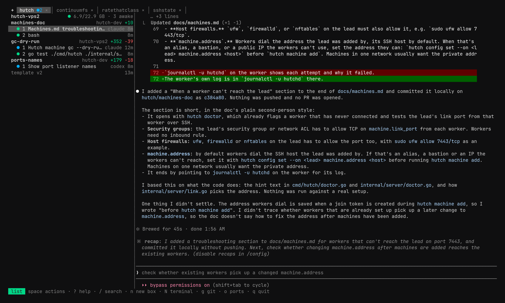

<p align="center"></p>

# Hutch

[Website](https://usehutch.dev) · [Documentation](https://usehutch.dev/docs/)

Every coding agent gets its own computer, on a Linux machine you rent or own. Hutch clones boxes from snapshots of your project's environment, keeps terminals running when you disconnect, and sleeps idle boxes. Machines with KVM run boxes as Firecracker microVMs; others use gVisor sandboxes.

<p align="center"></p>

- **A box per task.** Each box has its own files, processes, services, and Git branch, copied in seconds from your project's template.
- **Work that keeps going.** Agents carry on with your computer closed; attach again from anywhere and see where they are.
- **Your logins stay out of boxes.** Boxes hold placeholders; a proxy on the machine uses the real tokens only toward each agent's own hosts.
- **Your agents, as they are.** Claude Code and Codex are built in, with your config and MCP servers; any other agent CLI works through a TOML adapter.
- **One machine, or several.** Add machines for more boxes, with encrypted backups to an S3-compatible bucket.

Hutch is early software and hasn't had an independent security review. See the [release notes](docs/changelog.md) for current limitations.

## Install

On Linux or macOS:

```sh
curl -fsSL https://github.com/mouizahmed/hutch/releases/latest/download/install.sh | sh
```

For Windows, the machine's requirements, and checking a release, see [install and requirements](docs/install.md).

## First box

On an x86_64 Linux machine with systemd and Linux 6.1 or newer, reachable with `ssh` and passwordless sudo:

```sh
hutch setup <ssh-host>
hutch login claude gh          # or: hutch login codex gh
hutch user sync
cd /path/to/your/checkout
hutch init                     # then give .hutch/SETUP_PROMPT.md to your agent
hutch template snapshot
hutch new "Run the tests and fix any that fail"
hutch                          # the TUI
```

[First box](docs/quickstart.md) walks through each step.

## Documentation

- [Overview](docs/index.md) and [how Hutch works](docs/concepts.md)
- [Projects and templates](docs/templates.md), [boxes and terminals](docs/boxes.md), [the TUI](docs/tui.md)
- [Agents, logins, and MCPs](docs/agents.md), [configuration](docs/configuration.md)
- [Several machines](docs/machines.md), [backups and recovery](docs/backups.md), [troubleshooting](docs/troubleshooting.md)
- [CLI](docs/reference/cli.md) and [settings](docs/reference/settings.md) references, the [security model](docs/security.md)

To contribute, see [CONTRIBUTING.md](CONTRIBUTING.md) and the [architecture](docs/architecture.md). Report vulnerabilities privately through [SECURITY.md](SECURITY.md).

## License

[Apache-2.0](LICENSE)
