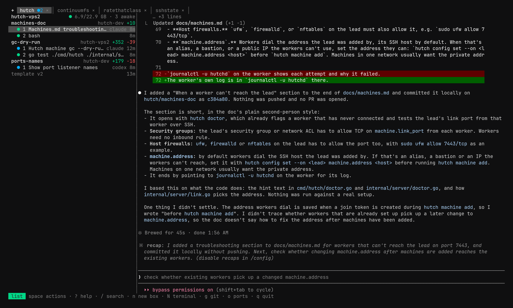
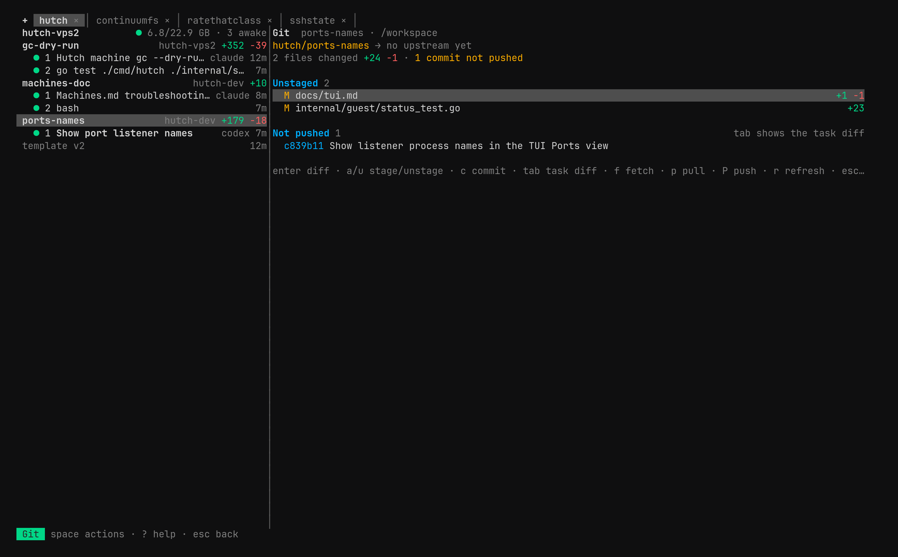

# The TUI

`hutch` with no command opens the TUI: your projects as tabs along the top, the open project's boxes and their terminals on the left, and the selected terminal, or a view, on the right. Everything the CLI does is reachable from it.

## The list

Each box shows its machine and, when it has work no remote has (committed or not), its lines, like `+352 −39`. Under it are its terminals, each with its agent or command and how long ago it started. The mark beside a terminal says what it's doing:

| | |
| --- | --- |
| orange spinner | Working |
| blue dot | Waiting, with output you haven't seen, like an agent's finished answer |
| green dot | Waiting, and you've seen it |
| purple dot | Its program exited |
| `z` | Its box is asleep |

A project's template has a row at the end of its list. Its pane says where the template stands, whether `.hutch/` changed since the newest version, the size from `hutch.toml`, and what the last build used at most, with the one key that moves it on: add a checkout (`p`), set it up (`i`, which runs `hutch init`), open the setup agent waiting in the template box (Enter), build (`b`), or snapshot the build as the next version (`S`). Until the size is confirmed, `b` and `S` get the whole terminal so the project form can ask for it first. Reading the row never wakes the template box.

## Keys

The footer always says where your keys go: the list, a view, or the terminal you're typing in.

| Key | |
| --- | --- |
| `j` `k` `↑` `↓` | Move through the list |
| Enter | Type into the selected terminal, waking its box first; **ctrl+]** gives the keys back |
| `n` | New box in this project |
| `N` | New terminal in the selected box |
| `s` | Sleep the box, or wake it |
| `d` | Remove the box or terminal (asked first); on a task row, cancel or dismiss it |
| `r` | Rename the terminal |
| `z` | Zoom the terminal to the whole screen |
| `\` | Put the terminal beside or below the list |
| `g` `o` `m` | The Git, Ports, and Machines views |
| `[` `]` | Previous or next project tab |
| `p` | Projects: bring back a closed one, or add a checkout |
| `x` | Close this tab |
| `/` | Search this project's boxes and terminals |
| Space | The action palette: every action |
| `?` | Every key and action |
| `q` | Quit; boxes and terminals keep running |

**Space** opens the palette in the list or any view: every action that applies to what's selected, found by typing any words of its name. One that doesn't apply says why instead of running. It has everything without a key, too: moving and resizing boxes, pull requests, `hutch local` and `hutch cloud`, template versions and checks, the serial console, logging in, `user sync`, config and grants, doctor, sizes, adding and upgrading machines, the bucket, and garbage collection.

**/** narrows the list to boxes and terminals whose names, agents, branches, or machines hold what you type; Esc clears it. Searching never wakes or starts anything.

## Projects

Each project you've opened is a tab. Click a tab, or use `[` and `]`, to switch; its `×` closes it. `+` brings back a closed tab or adds another checkout as a project, which registers it with the machine and starts nothing. Starting `hutch` inside a repository opens its tab.

## Tasks

Commands the TUI runs for you (a new box, a move, a push) show as rows at the top of the list, with their output in the pane. One that ends well leaves the list and says what it did; one that fails stays, with its error, until `d` dismisses it. When a new box or terminal fails or is canceled, the next `n` or `N` opens with the prompt you wrote; Esc there discards it.

`d` on a running task cancels it, after asking: it stops here, but the machine may already have done some of it. Quitting cancels what's still running, and stops it for good after `tui.cancel_grace`.

What asks questions or prints something to read (logins, editing config, `hutch local` and `hutch cloud`, adding or upgrading machines, doctor) gets the whole terminal, and comes back when it ends.

## Views

A view opens in the pane in place of the terminal; Esc goes back to the same selection. A terminal under a view doesn't count as seen and doesn't keep its box awake.

### Git (`g`)

The box's checkout as the agent sees it. The top line sums up its work: files and lines changed, and commits not yet pushed. Below are the staged, unstaged, untracked, and conflicted files with their lines, then the commits on no remote.

| Key | |
| --- | --- |
| Enter | The file's diff, with line numbers; `[` `]` move between hunks |
| `a` / `u` | Stage or unstage the whole file |
| `A` / `U` | Stage or unstage the hunk; refused if the file changed since it was shown |
| `c` | Commit what's staged; refused if that changed since it was shown |
| Tab | The task diff: everything since the base branch, committed or not |
| `f` | Fetch |
| `p` / `P` | Pull (fast-forward only) or push, each asked first; pull needs an upstream, and push sets one |
| `r` | Read the checkout again |

Looking changes nothing and contacts no remote. See [review and deliver work](git.md).

### Ports (`o`)

What the box listens on. Enter forwards a port to this computer's loopback, at the same port number, or another or any free one when that's taken; `a` forwards a port by number, `y` copies a forward's address, and `O` opens it in your browser. Forwards stay while you look elsewhere, and close when you stop them or quit. A forward to a sleeping box wakes it on its first connection. See [ports, SSH, and editors](networking.md).

### Machines (`m`)

Each machine's role, state, version, room, and boxes; adding and removing machines, removing one as lost, making another the lead, and upgrading them all. See [several machines](machines.md).
